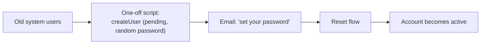

# Moving from another auth system

SelfAuth has no importer. Users and passwords from Passport, Auth0 or similar do not move automatically, because SelfAuth verifies only Argon2id hashes and never accepts other hash formats.

## The supported path

1. Run SelfAuth next to the old system. Add it with `npx selfauth add --allow-existing-auth` so the command continues even though the old auth packages are still installed.
2. Create the accounts with a one-off script that writes through the generated store. For each old user, call `createUser` with the user in the `pending` state and a password hash of a random secret nobody knows: `passwordHash: await auth.hasher.hash(<32 random bytes>)`.
3. Let each user set their own password through the normal reset flow (`POST /auth/password/reset-request`). Completing the reset proves they own the email and activates the account.
4. Never copy old password hashes.
5. Remove the old system once traffic has moved.

## Things to plan

- Email delivery. Every user receives a message. Warm up your provider and prepare the wording ([Send real email](/build/email)).
- Sessions. Users stay signed in to the old system until you retire it; SelfAuth sessions start at their first sign-in.
- Roles. Map the old roles to [your new roles](/build/permissions-roles) in the script.
- Rate limits. A reset wave from one office can hit per-address limits.

This path is outside what SelfAuth tests. Try it on a copy of your data first.
