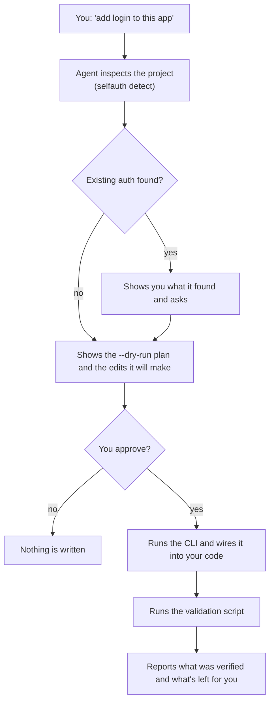

# Use the AI skill

If you work with a coding agent, this is the quickest way to get SelfAuth into a project. You install a small skill, then ask your agent for what you want in plain words, something like "add login to this app". The agent runs the SelfAuth CLI, wires the result into your code, and checks that it all works before telling you it's done.

The skill exists for a reason. Left alone, an agent will happily write its own password hashing and session code, and that's exactly where security mistakes come from. The skill keeps it on the tested path: generate the authentication with the CLI, never invent it.

It's entirely optional. SelfAuth works the same without any AI, and the generated code never depends on the skill.

## Install it

Run this in your project folder:

```bash
npx selfauth skill install --agent claude
```

Swap `claude` for `codex` or `cursor`, or use `all` for every agent. The files land where each agent looks for skills:

| Agent | Installs to | Call it by name |
| --- | --- | --- |
| Claude Code | `.claude/skills/selfauth/` | `/selfauth` |
| Codex | `.agents/skills/selfauth/` | `$selfauth` |
| Cursor | `.cursor/skills/selfauth/` | `/selfauth` |

### Install it for every project

If you'd rather have the skill available everywhere, install it once into your home folder:

```bash
npx selfauth skill install --global --agent claude
```

`--global` (or `-g`) puts the skill in your user-level skills folder, and every project you open with that agent can use it. It doesn't touch any project, and you don't pass a folder with it.

| Agent | Global install goes to |
| --- | --- |
| Claude Code | `~/.claude/skills/selfauth/` |
| Codex | `~/.agents/skills/selfauth/` |
| Cursor | `~/.cursor/skills/selfauth/` |

On Windows, `~` is your user folder, for example `C:\Users\you`. Restart the agent afterwards so it picks the skill up. The `--agent`, `--update` and `--dry-run` options work the same way.

Pick one or the other for a given agent. A project-level install is the one to commit when you want the whole team on the same version. A global install only affects your own machine, so teammates won't get it unless they install it too.

### Install it for one project

Commit the folder so everyone on the team gets the same behavior. After you upgrade the CLI, run the command again with `--update` so the skill matches the new commands. Use `--dry-run` first if you want to see what would be written.

You don't have to call the skill by name. The agent loads it whenever your request matches, for example "add login to this app" or "protect the orders routes".

## Per-agent notes

::: code-group

```text [Claude Code]
Claude Code finds project skills when it starts, so restart it after installing.

For every project at once, use `selfauth skill install --global`, which
writes to ~/.claude/skills/selfauth/.
```

```text [Codex]
Codex reads the skill's name and description up front, and the full
SKILL.md when a task matches.

If your setup relies on AGENTS.md instead of skills, add this paragraph to it
(the CLI doesn't edit AGENTS.md for you):

## Authentication
Use the SelfAuth skill in .agents/skills/selfauth/SKILL.md for any login,
session, role or permission work. Never hand-write authentication code; use
the SelfAuth CLI and follow the skill's rules and validation steps.
```

```text [Cursor]
Cursor also reads .claude/skills/, so if the project already has the Claude
Code install, you don't need a second copy.

If you only use Cursor rules, add .cursor/rules/selfauth.mdc instead:

---
description: Authentication, sessions, roles and permissions
alwaysApply: false
---
For login, session, role or permission work, follow
.cursor/skills/selfauth/SKILL.md. Never hand-write authentication code;
use the SelfAuth CLI.
```

:::

Any other agent that supports the Agent Skills format can use the folder as it is. For agents without skills support, point their instruction file (`AGENTS.md`, `CONVENTIONS.md` or a system prompt) at `.agents/skills/selfauth/SKILL.md` and tell it to use the SelfAuth CLI and never hand-write authentication code.

## What the agent needs

- Shell access, so it can run `node` and `npx selfauth`.
- Node.js 22.18 or newer. The skill's scripts are TypeScript and run without a build step.
- The ability to stop and ask you. The approval steps below aren't optional, so a fully unattended agent should stop at them.

## What happens when you ask

Here's the flow, so nothing about it is a surprise.



1. **It inspects the project** with `selfauth detect`: the framework, TypeScript and ESM, the database client, any existing auth, and which SelfAuth command applies. If nothing applies (a framework SelfAuth doesn't support), it stops and tells you instead of improvising.
2. **It deals with existing authentication carefully.** If it finds some, it shows you each file and line, explains that SelfAuth adds its own routes and sessions next to yours, and asks how to proceed. It won't delete or rewrite your auth unless you ask.
3. **It shows you the plan before writing anything.** That means the `--dry-run` output (the files the CLI will create), the edits it will make to your own files (server wiring, `tsconfig.json`, `.gitignore`, routes to protect), the permissions it will declare, and what stays manual. It waits for your approval.
4. **It runs the CLI and wires the result in**, using the guards and policies described in [Build your app](/build/add-api-route).
5. **It validates.** A validation script runs `selfauth validate` and `selfauth doctor`, then your project's own typecheck, tests and build. With the server running, it can also probe live routes to confirm anonymous requests are refused.
6. **It reports honestly.** Anything a check skipped is listed as not verified, and anything manual is listed as left for you.

## The rules it follows

These are built into the skill and aren't negotiable for the agent:

- It never hand-writes security code: password hashing, session or token generation, cookies, CSRF, rate limiting, permission checks. If the CLI can't generate it, the agent says so and stops.
- It never invents adapters. Only what `selfauth list` reports is supported. Ask for NestJS or Django and it tells you that's not supported, rather than porting the Express code.
- It never replaces or removes existing authentication without your approval.
- It never runs a destructive migration without your approval of the exact findings. It shows you `selfauth db plan` first.
- It never prints, logs or commits secrets such as `.env`, `DATABASE_URL`, `SELFAUTH_CSRF_SECRET`, passwords or tokens.
- It never says "done" until validation passes, and it reports every skipped check as not verified.
- It leaves the security core (`src/auth/**`) alone unless you ask. Behavior is changed through the [configuration file](/configuration/config-file).

## It can answer questions too

You don't have to want a change. Ask "does SelfAuth support MySQL?", "how do sessions work?" or "is this production ready?" and the skill answers from the documentation and the specification, separating what's supported now from what's planned. It's careful about trust: it won't call SelfAuth "audited" or "production-grade", because no independent audit has been done.

For a question about your own project ("will this work with my app?"), it inspects the project first and answers from what it finds.

## What it can't do for you

The agent finishes the wiring, but some things stay with you, and it will list them in its report:

- Choosing and configuring an email provider (see [Send real email](/build/email)).
- Creating the production database and setting `DATABASE_URL`.
- Deploying (see [Going to production](/advanced/production)).
- Deciding who gets which permissions. It proposes permissions from your domain, and you should read them.

::: warning Review the result
The skill makes the agent safer, not infallible. Read the diff before you commit, particularly the routes it protected and the permissions it declared, and run the app once yourself. SelfAuth is pre-alpha and has had no independent audit.
:::

## Machine-readable commands

The skill's scripts use the CLI's JSON output, which you can use yourself in scripts: `selfauth detect --json`, `list --json`, `doctor --json` and `validate --json`.

## Next

Try it with [prompts that work](./prompts), or skip the AI and follow the [quick start](/getting-started/quick-start).
