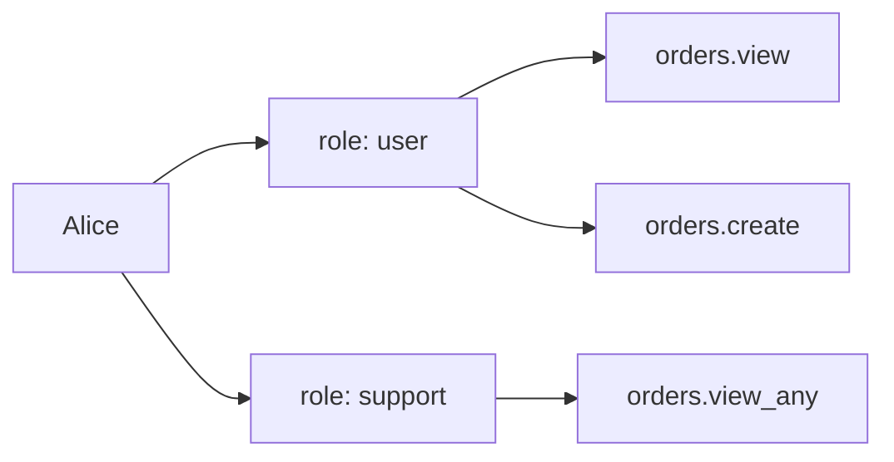

# Permissions and roles

SelfAuth uses RBAC (role-based access control):

- a permission is one thing someone may do, such as `orders.view`;
- a role is a named set of permissions, such as `user` or `support`;
- a user has roles, and holds all the permissions of those roles.



## Step 1: Declare permissions

In the configuration file (`src/config/selfauth.config.ts`, or `selfauth.config.json` for Gin) find `authorization`:

```ts
"authorization": {
  "strategy": "rbac",
  "permissions": [],
  "roles": { "user": [], "admin": [] },
  "defaultRoles": ["user"],
  "reauthenticationWindowMinutes": 15
}
```

If you ran `init --permissions orders.view,orders.create`, the `permissions` list already holds them. Otherwise add them:

```ts
"permissions": ["orders.view", "orders.create", "orders.view_any"],
```

Naming rules (checked at startup and by `selfauth validate`):

- two or more segments separated by dots: `orders.view`, `billing.invoices.refund`;
- each segment is lowercase letters, digits and underscores, starting with a letter;
- no wildcards (`orders.*` does not exist) and no "deny" permissions;
- the prefix `auth.` is reserved for SelfAuth's system permissions.

## Step 2: Give them to roles

::: warning Declared is not granted
Declaring a permission does not give it to anyone. A new project has `"user": []`: no permissions at all. Add each permission to the roles that should hold it.
:::

```ts
"roles": {
  "user": ["orders.view", "orders.create"],
  "support": ["orders.view_any"],
  "admin": ["orders.view_any"]
},
"defaultRoles": ["user"],
```

| Setting | Meaning |
| --- | --- |
| `roles` | Role name → list of permissions. Every listed permission must be declared (or be an `auth.` system permission). |
| `defaultRoles` | Roles every new account receives. Must exist. Must not include `admin`. |
| `admin` | Always exists and always holds every `auth.*` system permission, plus what you list. |

## Step 3: Write the roles to the database

The roles live in your database. The server never writes them for you in production. Run the seed after each change:

::: code-group

```bash [TypeScript (PostgreSQL, MySQL, SQLite, MongoDB)]
npm run db:seed
```

```bash [Gin]
go run ./cmd/seed
```

:::

With the in-memory store there is nothing to run: the server writes the roles at every start.

Then restart the server, because the configuration is read at startup. Users who are already signed in get their new permissions on their next request, since permissions are read from the database each time.

## Step 4: Check the result

Register and sign in a user, then call `/auth/me`. The `permissions` array lists what that user holds. This is real output after the change above:

```text
{"user":{"id":"f9108568-995f-4605-a6a7-bbb8c02b5036","email":"alice@example.com","emailVerified":true,"state":"active","roles":["user"],"permissions":["orders.create","orders.view"]}}
```

## The first administrator

Nobody becomes an administrator through the API, on purpose. After the person has registered and verified their email, you run on the server:

::: code-group

```bash [TypeScript]
npm run db:seed                              # makes sure the admin role exists
npm run db:create-admin admin@example.com
```

```bash [Gin]
go run ./cmd/seed
go run ./cmd/create-admin admin@example.com
```

:::

Expected output: `admin@example.com is now an administrator.` If the account is missing or not verified, it says "No active account with that email. Register and verify it first." and exits with code 1.

An administrator can then use the [administration routes](/api/http#administration) to suspend accounts and assign roles. Those routes also require a recent password entry: if the admin signed in more than 15 minutes ago (`reauthenticationWindowMinutes`), the call returns `REAUTHENTICATION_REQUIRED` and the admin must sign in again.

## System permissions

Used by SelfAuth's own administration routes. You do not declare them.

| Permission | Allows |
| --- | --- |
| `auth.users.read` | View any user's account data (never credentials) |
| `auth.users.manage` | Suspend, disable, re-activate or delete users |
| `auth.sessions.manage` | List and revoke other users' sessions |
| `auth.roles.assign` | Assign and remove roles |
| `auth.roles.manage` | Create and change roles and their permissions |
| `auth.audit.read` | Read security events |

Rules enforced for you: you cannot grant a permission you do not hold yourself, and the last administrator cannot be removed or deleted.

## Use the permission in your code

- Server: [`requirePermission("orders.view")`](./protect-routes)
- Frontend: [`<Can permission="orders.view">`](./frontend-pages#hide-parts-of-a-page-with-can) and route `meta: { permission: "orders.view" }`

## Common mistakes

| Mistake | Symptom | Fix |
| --- | --- | --- |
| Declared a permission but did not put it in a role | `403 FORBIDDEN` for everyone | Add it to a role, seed, restart |
| Changed roles but did not seed | Old permissions still apply | Run the seed |
| Used a permission in a guard that is not declared | The server fails at startup with `Unknown permission` | Declare it |
| Put `admin` in `defaultRoles` | `selfauth validate` fails | Remove it |
| Used `orders.*` or `Orders.View` | Configuration is rejected | Use `orders.view` |
