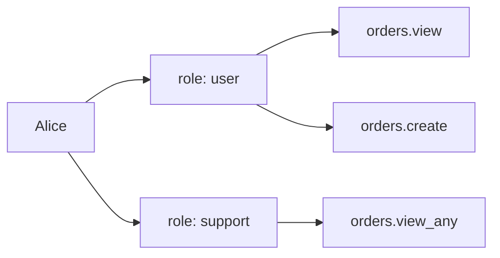

# Permissions and roles

SelfAuth uses role-based access control, usually shortened to RBAC. The idea is simple:

- A permission is one thing someone may do, like `orders.view`.
- A role is a named set of permissions, like `user` or `support`.
- A user has roles and ends up with every permission those roles carry.



## Step 1: Declare permissions

Open the configuration file (`src/config/selfauth.config.ts`, or `selfauth.config.json` for Gin) and find `authorization`:

```ts
"authorization": {
  "strategy": "rbac",
  "permissions": [],
  "roles": { "user": [], "admin": [] },
  "defaultRoles": ["user"],
  "reauthenticationWindowMinutes": 15
}
```

If you ran `init --permissions orders.view,orders.create`, the list already has those two. If not, add them:

```ts
"permissions": ["orders.view", "orders.create", "orders.view_any"],
```

Names have to follow a few rules, which are checked at startup and by `selfauth validate`:

- Two or more segments separated by dots, like `orders.view` or `billing.invoices.refund`.
- Each segment is lowercase letters, digits and underscores, and starts with a letter.
- No wildcards (there's no `orders.*`) and no "deny" permissions.
- The `auth.` prefix is reserved for SelfAuth's system permissions.

## Step 2: Give them to roles

::: warning Declared is not granted

Declaring a permission doesn't give it to anyone. A new project has `"user": []`, which means no permissions at all. Add each permission to whichever roles should have it.

:::

```ts
"roles": {
  "user": ["orders.view", "orders.create"],
  "support": ["orders.view_any"],
  "admin": ["orders.view_any"]
},
"defaultRoles": ["user"],
```

| Setting | Meaning |
| --- | --- |
| `roles` | Role name → list of permissions. Every listed permission must be declared (or be an `auth.` system permission). |
| `defaultRoles` | Roles every new account receives. Must exist. Must not include `admin`. |
| `admin` | Always exists and always holds every `auth.*` system permission, plus what you list. |

## Step 3: Write the roles to the database

Roles live in your database, and in production the server never writes them for you. Run the seed after each change:

::: code-group

```bash [TypeScript (PostgreSQL, MySQL, SQLite, MongoDB)]
npm run db:seed
```

```bash [Gin]
go run ./cmd/seed
```

:::

With the in-memory store there's nothing to run, because the server writes the roles at every start.

Then restart the server, since the configuration is only read at startup. People who are already signed in pick up their new permissions on their next request, because permissions are read from the database every time.

## Step 4: Check the result

Register and sign in a user, then call `/auth/me`. The `permissions` array shows what they hold. This is real output after the change above:

```text
{"user":{"id":"f9108568-995f-4605-a6a7-bbb8c02b5036","email":"alice@example.com","emailVerified":true,"state":"active","roles":["user"],"permissions":["orders.create","orders.view"]}}
```

## The first administrator

Nobody becomes an administrator through the API, and that's intentional. Once the person has registered and verified their email, you run this on the server:

::: code-group

```bash [TypeScript]
npm run db:seed                              # makes sure the admin role exists
npm run db:create-admin admin@example.com
```

```bash [Gin]
go run ./cmd/seed
go run ./cmd/create-admin admin@example.com
```

:::

You should see `admin@example.com is now an administrator.` If the account doesn't exist or isn't verified, you get "No active account with that email. Register and verify it first." and exit code 1.

The admin can then use the [administration routes](/api/http#administration) to suspend accounts and assign roles. Those routes also ask for a recent password entry. If the admin signed in more than 15 minutes ago (`reauthenticationWindowMinutes`), the call returns `REAUTHENTICATION_REQUIRED` and they need to sign in again.

## System permissions

SelfAuth's own administration routes use these. You don't declare them yourself.

| Permission | Allows |
| --- | --- |
| `auth.users.read` | View any user's account data (never credentials) |
| `auth.users.manage` | Suspend, disable, re-activate or delete users |
| `auth.sessions.manage` | List and revoke other users' sessions |
| `auth.roles.assign` | Assign and remove roles |
| `auth.roles.manage` | Create and change roles and their permissions |
| `auth.audit.read` | Read security events |

A couple of rules are enforced for you: you can't grant a permission you don't hold, and the last administrator can't be removed or deleted.

## Using a permission in your code

- Server: [`requirePermission("orders.view")`](./protect-routes)
- Frontend: [`<Can permission="orders.view">`](./frontend-pages#hide-parts-of-a-page-with-can) and route `meta: { permission: "orders.view" }`

## Common mistakes

| Mistake | Symptom | Fix |
| --- | --- | --- |
| Declared a permission but did not put it in a role | `403 FORBIDDEN` for everyone | Add it to a role, seed, restart |
| Changed roles but did not seed | Old permissions still apply | Run the seed |
| Used a permission in a guard that is not declared | The server fails at startup with `Unknown permission` | Declare it |
| Put `admin` in `defaultRoles` | `selfauth validate` fails | Remove it |
| Used `orders.*` or `Orders.View` | Configuration is rejected | Use `orders.view` |
