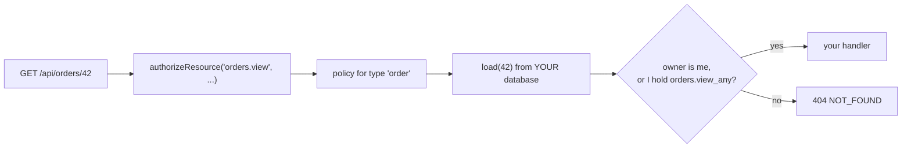

# Resources and ownership

A permission like `orders.view` says a user may view orders. It doesn't say whose. Stop there and any user can read everyone's orders just by guessing ids.

This guide adds the missing half, an ownership policy, so that:

- A user sees and opens only their own orders.
- A user with the extra permission `orders.view_any` (support staff, say) can see everyone's.
- Other people's orders look like they don't exist. You get a `404` rather than a `403`, so nobody can probe for ids.

## How it fits together



| Piece | What it is |
| --- | --- |
| Policy | A rule for one type of object. `ownershipPolicy(load)` is the ready-made "owner, or holder of `<action>_any`" rule. You supply `load(id)`, which fetches the object from your database. |
| `authorizeResource` | A guard for routes with an id. It runs the policy and answers `404` if the policy says no. |
| `ownerFilter` | For list routes. It tells you which owner to filter the query by, so you never fetch other people's rows. |

::: warning Always load from the database

`load` has to read the object from your own storage, never from the request body or query. If an attacker could say who owns something, the check would mean nothing.

:::

## Step 1: Declare permissions and give them to roles

In your configuration:

```ts
"permissions": ["orders.view", "orders.create", "orders.view_any"],
"roles": {
  "user": ["orders.view", "orders.create"],
  "support": ["orders.view_any"],
  "admin": []
},
```

Run the seed and restart, as in [Permissions and roles](./permissions-roles). The `_any` suffix is the convention the helpers look for: `ownershipPolicy` allows `orders.view` for the owner, or for anyone holding `orders.view_any`. Someone with only `orders.view_any` can open single orders, but the list route has its own `orders.view` guard, so give support staff both if they need the list.

## Step 2: Write the routes

The example keeps orders in an array so it runs without a database. Swap the array for real queries when you're ready (see [Change the database](./database-changes)).

::: code-group

```ts [Express: src/routes/orders.ts]
import express from "express";
import { ownerFilter, ownershipPolicy, type Auth } from "../auth/index.ts";

interface Order {
  id: string;
  ownerId: string;
  item: string;
}
const orders: Order[] = []; // replace with your database

export function orderRoutes(auth: Auth): express.Router {
  // 1. A policy for the resource type "order".
  auth.policies.register(
    "order",
    ownershipPolicy(async (id) => {
      const o = orders.find((x) => x.id === id);
      return o ? { type: "order", id: o.id, ownerId: o.ownerId } : null;
    }),
  );

  // 2. Deny-by-default routes.
  const routes = auth.protectedRoutes();

  // List: filter in the query by owner.
  routes.get("/", auth.requirePermission("orders.view"), (_req, res) => {
    const filter = ownerFilter(auth.context(res)!, "orders.view");
    res.json(orders.filter((o) => !filter?.ownerId || o.ownerId === filter.ownerId));
  });

  // Create: the owner is the signed-in user, never taken from the body.
  routes.post("/", auth.requirePermission("orders.create"), (req, res) => {
    const order = {
      id: crypto.randomUUID(),
      ownerId: auth.context(res)!.userId,
      item: String(req.body?.item ?? ""),
    };
    orders.push(order);
    res.status(201).json(order);
  });

  // One order: the policy decides.
  routes.get(
    "/:id",
    auth.authorizeResource("orders.view", (req) => ({
      type: "order",
      id: String(req.params["id"]),
    })),
    (req, res) => res.json(orders.find((o) => o.id === req.params["id"])),
  );

  return routes.router;
}
```

```ts [Fastify: src/routes/orders.ts]
import type { FastifyInstance } from "fastify";
import { ownerFilter, ownershipPolicy, type Auth } from "../auth/index.ts";

interface Order {
  id: string;
  ownerId: string;
  item: string;
}
const orders: Order[] = []; // replace with your database

export function orderRoutes(app: FastifyInstance, auth: Auth): void {
  auth.policies.register(
    "order",
    ownershipPolicy(async (id) => {
      const o = orders.find((x) => x.id === id);
      return o ? { type: "order", id: o.id, ownerId: o.ownerId } : null;
    }),
  );

  const routes = auth.protectedRoutes(app, "/api/orders");

  routes.get("/", auth.requirePermission("orders.view"), async (req) => {
    const filter = ownerFilter(auth.context(req)!, "orders.view");
    return orders.filter((o) => !filter?.ownerId || o.ownerId === filter.ownerId);
  });

  routes.post("/", auth.requirePermission("orders.create"), async (req, reply) => {
    const body = (req.body ?? {}) as { item?: string };
    const order = {
      id: crypto.randomUUID(),
      ownerId: auth.context(req)!.userId,
      item: String(body.item ?? ""),
    };
    orders.push(order);
    return reply.code(201).send(order);
  });

  routes.get(
    "/:id",
    auth.authorizeResource("orders.view", (req) => ({
      type: "order",
      id: String((req.params as { id: string }).id),
    })),
    async (req) => orders.find((o) => o.id === (req.params as { id: string }).id),
  );
}
```

```go [Gin: internal/routes/orders.go]
package routes

import (
	"context"
	"net/http"
	"strconv"
	"sync"

	"github.com/you/my-api/internal/auth"
	"github.com/you/my-api/internal/ginauth"
	"github.com/you/my-api/internal/httpx"
	"github.com/gin-gonic/gin"
)

type order struct {
	ID      string `json:"id"`
	OwnerID string `json:"ownerId"`
	Item    string `json:"item"`
}

var (
	mu     sync.Mutex
	orders []order // replace with your database
)

func find(id string) *order {
	for i := range orders {
		if orders[i].ID == id {
			return &orders[i]
		}
	}
	return nil
}

// registerOrders mounts /api/orders. Call it from Register in routes.go.
func registerOrders(r *gin.Engine, a *ginauth.Auth) {
	a.Policies().Register("order", auth.OwnershipPolicy(
		func(_ context.Context, id string) (*auth.Resource, error) {
			mu.Lock()
			defer mu.Unlock()
			if o := find(id); o != nil {
				return &auth.Resource{Type: "order", ID: o.ID, OwnerID: o.OwnerID}, nil
			}
			return nil, nil
		}))

	routes := a.ProtectedRoutes(r.Group("/api/orders"))

	routes.GET("", a.RequirePermission("orders.view"), func(c *gin.Context) {
		owner, all, _ := auth.OwnerFilter(a.Context(c).Subject, "orders.view")
		mu.Lock()
		defer mu.Unlock()
		out := []order{}
		for _, o := range orders {
			if all || o.OwnerID == owner {
				out = append(out, o)
			}
		}
		c.JSON(http.StatusOK, out)
	})

	routes.POST("", a.RequirePermission("orders.create"), func(c *gin.Context) {
		item, _ := httpx.Body(c)["item"].(string) // SelfAuth's middleware already parsed the body
		o := order{OwnerID: a.Context(c).UserID, Item: item}
		mu.Lock()
		o.ID = strconv.Itoa(len(orders) + 1)
		orders = append(orders, o)
		mu.Unlock()
		c.JSON(http.StatusCreated, o)
	})

	routes.GET("/:id",
		a.AuthorizeResource("orders.view", func(c *gin.Context) (string, string) { return "order", c.Param("id") }),
		func(c *gin.Context) {
			mu.Lock()
			defer mu.Unlock()
			c.JSON(http.StatusOK, find(c.Param("id")))
		})
}
```

:::

Replace `github.com/you/my-api` with your module path, the first line of `go.mod`.

## Step 3: Mount the routes

::: code-group

```ts [Express: src/routes/index.ts]
import { orderRoutes } from "./orders.ts";

export function mountRoutes(app: express.Express, auth: Auth): void {
  // ...your existing routes...
  app.use("/api/orders", orderRoutes(auth));
}
```

```ts [Fastify: src/routes/index.ts]
import { orderRoutes } from "./orders.ts";

export function mountRoutes(app: FastifyInstance, auth: Auth): void {
  // ...your existing routes...
  orderRoutes(app, auth);
}
```

```go [Gin: internal/routes/routes.go]
func Register(r *gin.Engine, a *ginauth.Auth) {
	registerOrders(r, a)
	// ...your existing routes...
}
```

:::

## Step 4: Try it

Register two users, Alice and Bob, verify them and sign each in with their own cookie file (`ja.jar` and `jb.jar`), as in [Try the authentication flow](/getting-started/first-flow). Then:

```bash
curl "${H[@]}" -b ja.jar localhost:3000/api/orders -d '{"item":"coffee"}'   # Alice creates an order
curl "${H[@]}" -b ja.jar localhost:3000/api/orders                           # Alice lists
curl "${H[@]}" -b jb.jar localhost:3000/api/orders                           # Bob lists
curl "${H[@]}" -b ja.jar localhost:3000/api/orders/ORDER_ID                  # Alice opens it
curl "${H[@]}" -b jb.jar localhost:3000/api/orders/ORDER_ID                  # Bob opens it
curl "${H[@]}" localhost:3000/api/orders                                     # nobody signed in
```

Output (real, from the Express version):

```text
{"id":"2c5384b7-3f36-4932-8ded-7518b2cd47a2","ownerId":"f9108568-995f-4605-a6a7-bbb8c02b5036","item":"coffee"}
[{"id":"2c5384b7-3f36-4932-8ded-7518b2cd47a2","ownerId":"f9108568-995f-4605-a6a7-bbb8c02b5036","item":"coffee"}]
[]
{"id":"2c5384b7-3f36-4932-8ded-7518b2cd47a2","ownerId":"f9108568-995f-4605-a6a7-bbb8c02b5036","item":"coffee"}
{"error":{"code":"NOT_FOUND","message":"Not found.","requestId":"82924c89-89fc-465f-99a7-69c0dafe0a85"}}
{"error":{"code":"UNAUTHENTICATED","message":"Authentication required.","requestId":"c2791f7f-f840-4df9-b50b-f38427546867"}}
```

Bob's list is empty, and when he tries to open Alice's order he gets `404`, the same answer as for an order that doesn't exist. The Fastify and Gin versions behave identically.

## How the helpers decide

| Helper | Allows when |
| --- | --- |
| `ownershipPolicy(load)` | the user holds `<action>` and `resource.ownerId` equals their id, or the user holds `<action>_any` |
| `ownerFilter(context, action)` | returns `{ ownerId }` to filter by, or an object without an owner when the user holds `<action>_any`, or `null` when they hold neither |
| `authorizeResource(action, getResource)` | the policy registered for the resource `type` says allow. No policy registered for the type means `403 FORBIDDEN` |

## Other kinds of rules

Ownership is just one rule. For tenants, status checks or sharing, write your own policy instead of using `ownershipPolicy`:

```ts
auth.policies.register("document", {
  load: async (id) => { /* read from your database */ },
  authorize(subject, action, resource) {
    return subject.permissions.has(action) && resource["tenantId"] === /* the subject's tenant */ "";
  },
});
```

A policy is two functions. `load(id)` returns the resource, or `null` if it doesn't exist, and `authorize(subject, action, resource)` returns `true` or `false`. The subject is `{ userId, roles, permissions }`.

## Checklist

- [ ] The list route filters in the query with `ownerFilter`, rather than fetching everything and hiding rows afterwards.
- [ ] The create route takes the owner from the session, not the request body.
- [ ] `load` reads from your database.
- [ ] Update and delete routes use `authorizeResource` with their own permission, such as `orders.update`.
