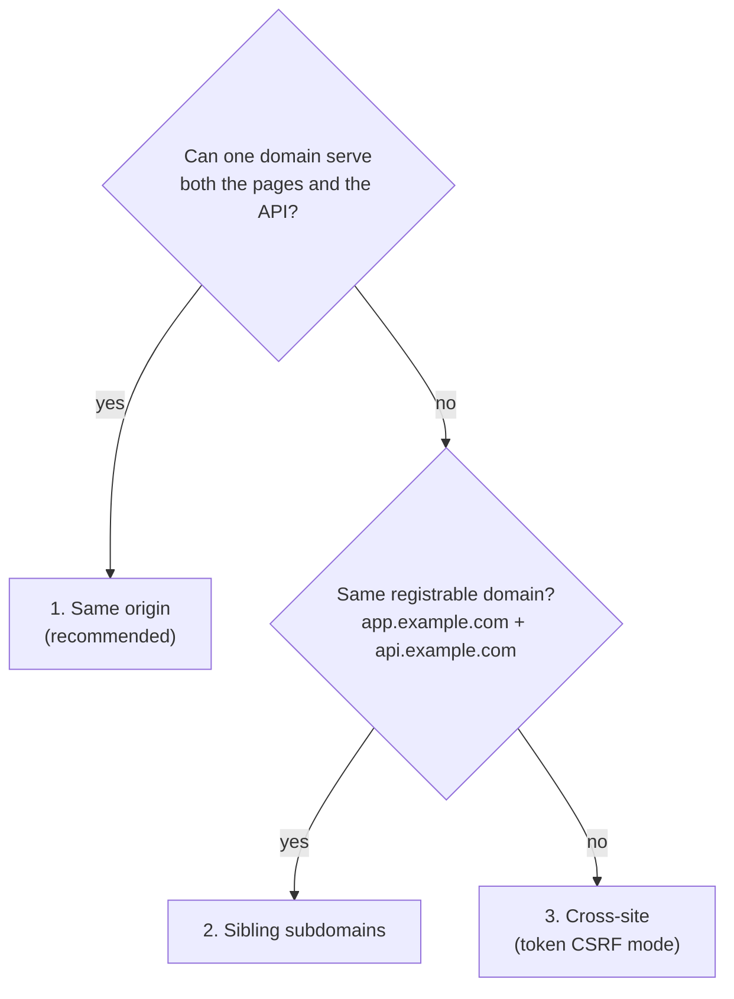

# Frontend deployment: cookies, CORS and CSRF

SelfAuth sessions are HttpOnly cookies, so where you serve the frontend relative to the API decides your cookie, CORS and CSRF settings. Use the first setup below that fits.



## 1. Same origin (recommended)

The browser talks to one address, say `https://app.example.com`. The frontend is served from there, and `/auth` and `/api` are proxied to the backend. Local development already works this way, with Vite doing the proxying.

| Setting | Value |
| --- | --- |
| `sessions.cookie` | the defaults: `__Host-session`, `Secure`, `SameSite=Lax` |
| `http.trustedOrigins` | not needed |
| `http.csrf.mode` | `header` (default) |
| CORS | none |
| `SELFAUTH_APP_BASE_URL` | `https://app.example.com` |
| Client | `createAuthClient({})` (same origin, the default) |

An nginx fragment would look like this:

```nginx
location /auth { proxy_pass http://127.0.0.1:3000; proxy_set_header X-Forwarded-For $remote_addr; }
location /api  { proxy_pass http://127.0.0.1:3000; proxy_set_header X-Forwarded-For $remote_addr; }
location /     { root /var/www/app; try_files $uri /index.html; }
```

The API now sits behind a proxy, so set `http.trustProxy: 1`. Otherwise rate limits see the proxy's address instead of the real client's.

## 2. Same site, different subdomains

The frontend is on `https://app.example.com` and the API on `https://api.example.com`.

| Setting | Value |
| --- | --- |
| `sessions.cookie` | `SameSite=Lax`, `Secure`. Leave the cookie host-only on the API's domain |
| `http.trustedOrigins` | `["https://app.example.com"]` |
| `http.csrf.mode` | `header` |
| CORS | handled by SelfAuth: credentials are allowed only for trusted origins |
| `SELFAUTH_APP_BASE_URL` | `https://app.example.com` |
| Client | `createAuthClient({ baseUrl: "https://api.example.com" })` |

Avoid setting a `Domain` on the cookie unless you have to. It shares the cookie with every subdomain, including ones you may not control.

## 3. Cross-site (different registrable domains)

Here the frontend is on `https://myapp.dev` and the API on `https://api.other.io`. Browsers only send the cookie with `SameSite=None`, which switches off the browser's own CSRF protection, so token mode is mandatory.

| Setting | Value |
| --- | --- |
| `sessions.cookie.sameSite` | `none` (the schema requires `secure: true`) |
| `http.csrf.mode` | `token` (the schema enforces it) |
| `SELFAUTH_CSRF_SECRET` | 32+ random bytes, base64url |
| `http.trustedOrigins` | `["https://myapp.dev"]` |
| Client | `createAuthClient({ baseUrl: "https://api.other.io", csrf: { mode: "token" } })` |

In token mode the header carries a token tied to the session (returned by `login`, `me` and `password/change`) instead of the fixed value `1`. The client keeps it in memory and refreshes it from `GET /auth/me` after a reload. Some browsers block third-party cookies altogether, and if that's a problem for you, use setup 1 or 2.

## Rules for every topology

- Never keep session or CSRF tokens in `localStorage` or `sessionStorage`.
- Route guards and `<Can>` are conveniences. The API authorizes every request.
- Email links land on frontend pages (`/verify-email`, `/reset-password`) with the token in the URL fragment. Those pages must send `Referrer-Policy: no-referrer` (set it on your static host and keep the `<meta name="referrer">` tag) and remove the fragment immediately. The generated pages already do both.
- Send post-login redirects through `safeRedirect`.
- Use HTTPS everywhere in production. The server refuses to start in production unless `SELFAUTH_APP_BASE_URL` is `https://`, and the cookie is `Secure`. Once every subdomain serves HTTPS, add HSTS at your proxy, for example `Strict-Transport-Security: max-age=31536000; includeSubDomains`.

## Using Gin with a Vue or React app

Gin has no generated frontend, but the Vue and React apps from `init --frontend` or `selfauth add-frontend` work against it. Point the dev proxy (`SELFAUTH_API_TARGET`) at the Go server and use one of the setups above.

## Troubleshooting

A `403 CSRF_FAILED` on every POST usually means the frontend's origin isn't trusted or the header is missing. See [Troubleshooting](/troubleshooting#403-csrf_failed).
