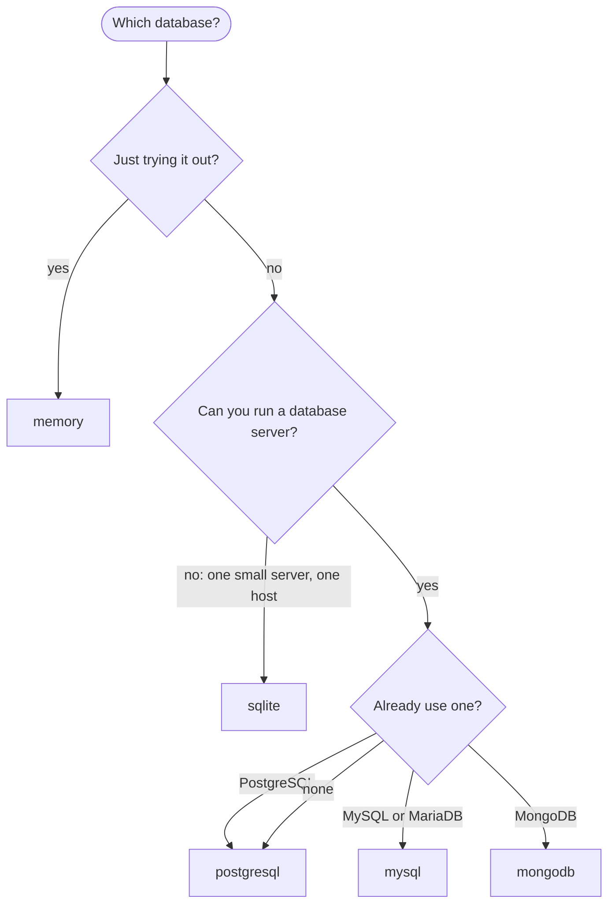

# Choose your stack

`selfauth init` asks for three things: a backend, a database and a frontend. There's no switch to flip later, so it's worth a minute to think about them now. If you do change your mind, generate a fresh project and move your own files across.

## 1. Backend

| Backend | Language | Choose it when | Notes |
| --- | --- | --- | --- |
| Express 5 | TypeScript | You know Express, or you have no preference | The reference implementation. Default. |
| Fastify 5 | TypeScript | You prefer Fastify | Same core and behavior as Express, with a Fastify adapter. |
| Gin | Go 1.26+ | Your team writes Go | A Go port of the same core. New projects only. Works with every database. |

All three backends pass the same 90 conformance cases.

## 2. Database



| Database | Choose it when | Limits |
| --- | --- | --- |
| `postgresql` | Real use, several app servers. Recommended. | None |
| `mysql` | You already run MySQL 8 or MariaDB | Claimed at "authorization level" until its production profile is reviewed |
| `sqlite` | One server, no database to operate | One file on one host. Not for several app instances |
| `mongodb` | You already run MongoDB | Claimed at "authorization level" until its production profile is reviewed. Uses indexes, not migrations |
| `memory` | A first look, demos, tests | Data is lost on restart. Refused in production. |

## 3. Frontend

| Option | You get |
| --- | --- |
| `none` | An API only. Use this when you already have a frontend, or are building a mobile app or another service. |
| `vue` | A Vue 3 + Vite app in `client/` with every account screen. |
| `react` | A React + Vite app in `client/` with every account screen. |

Every frontend works with every backend. With Gin, the frontend is generated as `client/` next to the Go server in `server/`: see [Gin (Go) API](/structure/gin#with-a-frontend).

## A sensible first choice

```bash
npx selfauth init my-app --backend express --database memory --frontend vue
```

That gives you Express, no database to install, and a complete app with screens. When you're ready for a real database, [Change the database](/build/database-changes) shows how.
