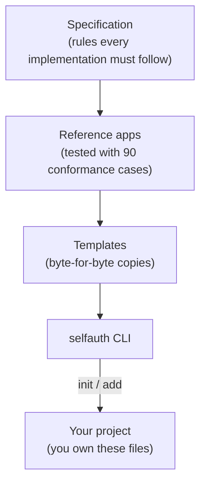
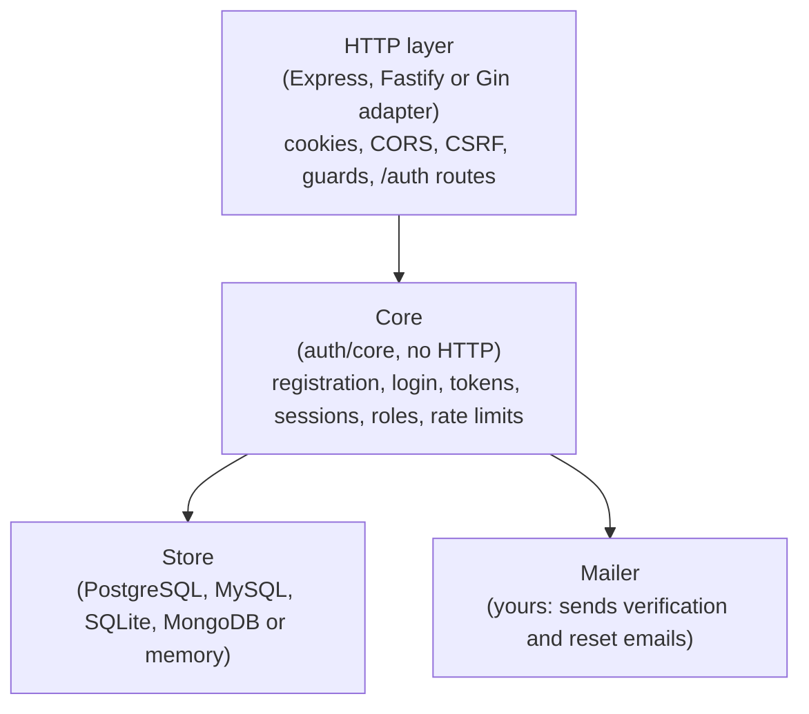
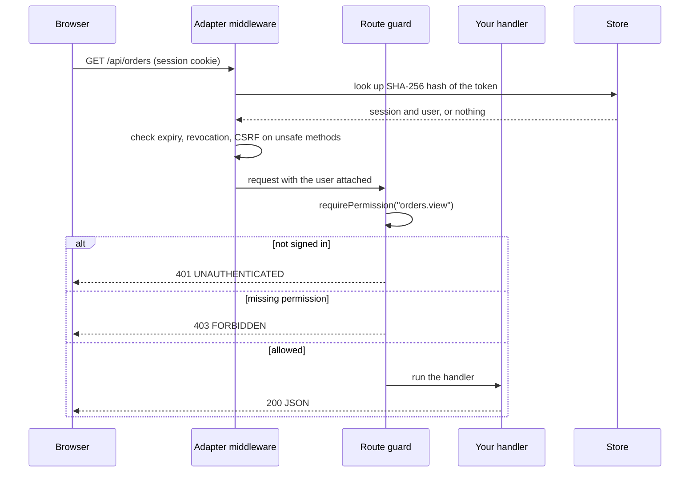
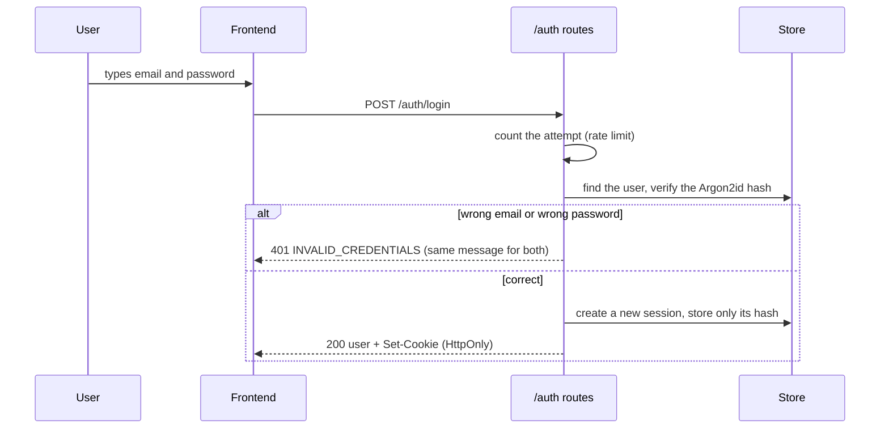

# How SelfAuth works

There are really two separate things here. The generator runs once, on your machine, while you set up the project. The app it produces is what runs in production, and it never needs the generator again.

## The generator

1. A written specification says what authentication has to do and what it must never do.
2. Reference apps implement that spec for each framework, and a suite of 90 conformance cases runs against every one.
3. The templates the CLI copies are those same tested apps, unchanged.
4. `selfauth init` copies a template into your folder and records what it wrote in `selfauth.manifest.json`.

Since the template is the tested app, there's no second "generated" flavor that could drift from what was tested.

## The generated app

Every generated backend has the same four pieces.

- The core holds the rules (registration, login, tokens, sessions, roles) and knows nothing about HTTP. It's identical across frameworks.
- The adapter translates between the web framework and the core: requests in, responses out.
- The store is where data lands. You can swap it for another database.
- The mailer is yours. SelfAuth has no idea which email provider you use, so it hands you the message and you send it.

## One request, step by step

Here's what happens when a browser asks for a protected route like `GET /api/orders`.

A few things to take from that:

- The cookie holds a random token, not any data about the user. Your server looks the session up on every request, which is why a revoked session stops working straight away.
- Permissions come from the database on each request, so the browser can't give itself any.
- Hiding a button in the UI is polish. The server is what actually says yes or no.

## The sign-in flow

The login attempt is counted before the password is checked. And when the email doesn't exist, the server still runs a dummy hash check, so a fast "no such user" response doesn't leak that fact.

## Where the pieces live

| Piece | Folder (TypeScript) | Folder (Go) |
| --- | --- | --- |
| Rules, no HTTP | `src/auth/core/` | `internal/auth/` |
| HTTP binding | `src/auth/express/` or `src/auth/fastify/` | `internal/ginauth/` |
| Data stores | `src/auth/stores/` | `internal/store/` |
| Your routes | `src/routes/` | `internal/routes/` |
| Settings | `src/config/selfauth.config.ts` | `selfauth.config.json` |

Every file in those folders is described on the [project structure](/structure/) pages.
