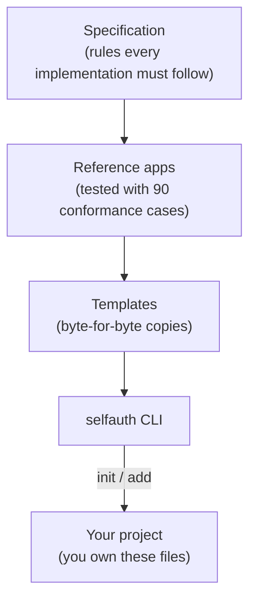
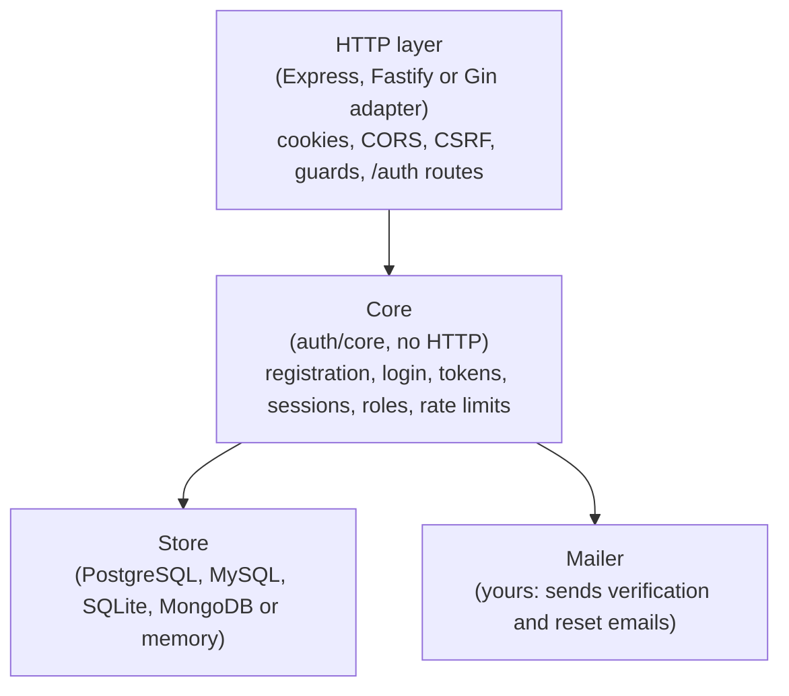
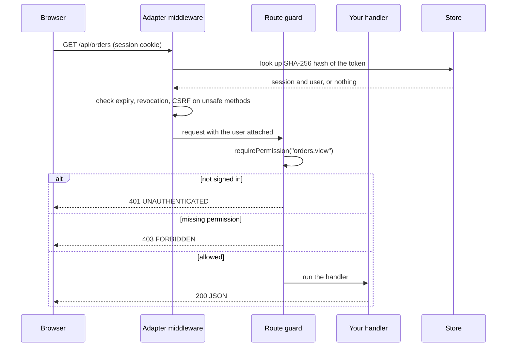
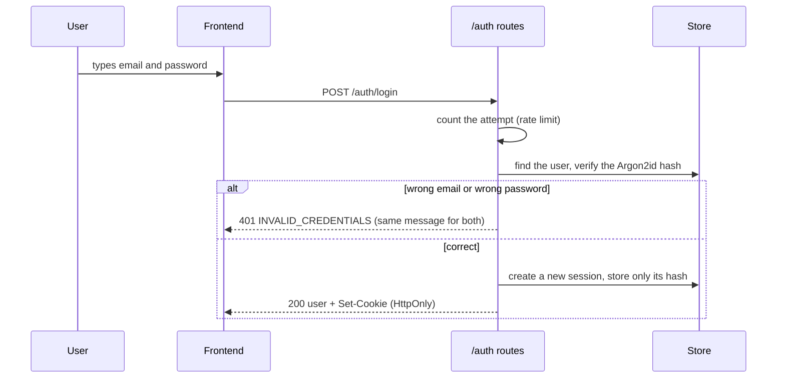

# How SelfAuth works

There are two separate worlds: **the generator** that you run once on your computer, and **the generated app** that runs in production.

## The generator

1. A **specification** describes what authentication must do and what it must never do.
2. **Reference apps** implement the specification for each framework. A **conformance suite** of 90 test cases runs against every one of them.
3. The **templates** the CLI copies are exactly those tested apps.
4. `selfauth init` writes a template into your folder and records what it wrote in `selfauth.manifest.json`.

Because the template is the tested app, there is no separate "generated version" that might behave differently.

## The generated app

A generated backend has four layers.

- The **core** contains all the rules and no web code. It is the same logic in every framework.
- The **adapter** turns HTTP requests into core calls and core results into HTTP responses.
- The **store** saves data. You can swap it.
- The **mailer** is yours: SelfAuth cannot know which email provider you use.

## One request, step by step

This is what happens when the browser calls a protected route such as `GET /api/orders`.

Three details matter:

- The cookie holds a random token, not data. Your server looks the session up on **every** request, so a revoked session stops working immediately.
- Permissions are read from the database on the server for each request. The browser cannot grant itself anything.
- Frontend checks such as hiding a button are only for convenience. The server decides.

## The sign-in flow

The attempt is counted **before** the password is checked, and an unknown email still goes through a dummy hash check, so response time does not reveal whether an account exists.

## Where the pieces live

| Piece | Folder (TypeScript) | Folder (Go) |
| --- | --- | --- |
| Rules, no HTTP | `src/auth/core/` | `internal/auth/` |
| HTTP binding | `src/auth/express/` or `src/auth/fastify/` | `internal/ginauth/` |
| Data stores | `src/auth/stores/` | `internal/store/` |
| Your routes | `src/routes/` | `internal/routes/` |
| Settings | `src/config/selfauth.config.ts` | `selfauth.config.json` |

See [Project structure](/structure/) for every file.

## Next

- [Concepts and terms](./concepts)
