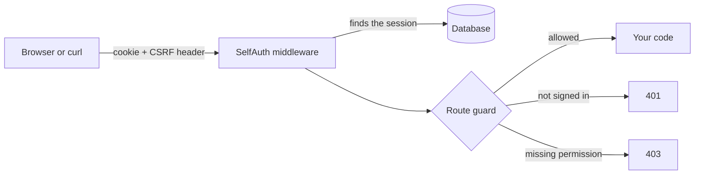

# How it works

You don't need to understand all of this to follow the guides, but it helps to know what happens when a request reaches your app.

## One request, step by step

1. **The browser sends a cookie.** When someone signs in, SelfAuth stores a session in your database and sends the browser a cookie with a random id. The cookie is `HttpOnly`, so JavaScript on the page can't read it.
2. **The middleware looks up the session.** On every request it finds the session, checks it hasn't expired, and loads the user with their roles and permissions.
3. **A guard checks the route.** Each of your routes says who may call it: anyone, any signed-in user, or users with a given permission. Someone who isn't signed in gets `401`. Someone without the permission gets `403`.
4. **Your code runs.** By the time your handler runs, the user is known. You read their id with `auth.context(...)` and get on with your feature.

## The words you'll see

**Session.** A row in the database that says "this browser belongs to this user until this time". Signing out deletes it.

**Permission.** A name for one thing a user can do, like `notes.create`. You choose the names. The convention is `thing.action`.

**Role.** A named set of permissions, like `user` or `admin`. Users get roles, and roles hold permissions. Every new account gets the `user` role.

**CSRF.** Cross-site request forgery: another website tricking your browser into sending a request to your app with your cookie. SelfAuth blocks it by requiring a header (`X-SelfAuth-CSRF: 1`) on every request that changes something. Other websites can't add that header. The generated frontend sends it for you.

**Migration.** A file of SQL that changes your database, like creating a table. You keep migrations in your project and apply them with `selfauth db migrate`. The server never changes the database by itself when it starts.

**Seed.** Writing your roles and permissions from the configuration file into the database. You run it after changing them.

## Where things live

| What | Where |
| --- | --- |
| Settings: roles, permissions, password rules, session length | The configuration file (`selfauth.config.ts`, or `selfauth.config.json` for Gin and Flask) |
| Secrets and addresses | Environment variables, in `.env` during development |
| Your routes | `src/routes/` (Gin: `internal/routes/`) |
| SelfAuth's own code | `src/auth/` (Gin: `internal/auth/` and `internal/ginauth/`). You read it, but you don't need to change it. |

## The security defaults

- Passwords are hashed with Argon2id. Common passwords are refused.
- Signing in, registering and password resets are rate limited per account and per address.
- Sign-in and password reset answer the same way whether or not an email is registered, so nobody can probe which emails have accounts.
- Every route you add is checked on the server. Hiding a button in the frontend is a convenience, never the protection.

Ready to build? [Pick your stack](./pick-your-stack).
