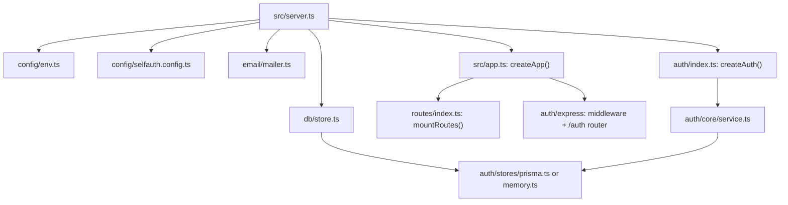

# Express API project structure

This is what `npx selfauth init my-app` creates (Express, PostgreSQL, no frontend). With `--database memory`, the `prisma/` folder, `prisma.config.ts`, the Prisma store and the `src/scripts/` folder are left out.

## The tree

```text
my-app/
├── src/
│   ├── server.ts                  # starts the server (reads env, builds stores, creates auth)
│   ├── app.ts                     # builds the Express app: middleware, /health, /auth, your routes, errors
│   ├── routes/
│   │   └── index.ts               # ★ YOUR routes (the example GET /api/hello lives here)
│   ├── config/
│   │   ├── selfauth.config.ts     # ★ authentication and authorization settings
│   │   ├── env.ts                 # reads and validates environment variables
│   │   └── dev-config.ts          # relaxes cookie settings for http://localhost
│   ├── email/
│   │   └── mailer.ts              # ★ plug in your email provider here
│   ├── db/
│   │   └── store.ts               # picks the data store: PostgreSQL, or memory without DATABASE_URL
│   ├── http/
│   │   ├── errors.ts              # HttpError and the error response format
│   │   └── request-id.ts          # gives every request an id
│   ├── auth/                      # ⚠ the security core: do not edit
│   │   ├── index.ts               # createAuth(), syncRoles(), ownershipPolicy(), ...
│   │   ├── types.ts               # the configuration type
│   │   ├── core/                  # rules with no web code
│   │   │   ├── service.ts         #   register, login, sessions, tokens, admin operations
│   │   │   ├── password.ts        #   Argon2id hashing
│   │   │   ├── crypto.ts          #   random tokens and hashes
│   │   │   ├── rate-limit.ts      #   the rate limiter
│   │   │   ├── authorization.ts   #   permissions, policies, ownership helpers
│   │   │   ├── store.ts           #   the AuthStore interface (what a database must do)
│   │   │   ├── mailer.ts          #   the Mailer interface and dev/test mailers
│   │   │   ├── email.ts           #   email normalization and validation
│   │   │   ├── errors.ts          #   error codes
│   │   │   ├── logger.ts          #   logger that redacts secrets
│   │   │   ├── clock.ts           #   time source (replaceable in tests)
│   │   │   └── common-passwords.ts#   list of passwords that are refused
│   │   ├── express/
│   │   │   └── index.ts           # the Express adapter: cookies, CORS, CSRF, guards, /auth routes
│   │   └── stores/
│   │       ├── memory.ts          # in-memory store
│   │       └── prisma.ts          # PostgreSQL store (Prisma)
│   └── scripts/
│       ├── seed.ts                # writes roles and permissions to the database
│       └── create-admin.ts        # gives an existing account the admin role
├── test/
│   └── auth.smoke.test.ts         # ★ tests of the wiring (yours to extend)
├── prisma/                        # PostgreSQL only
│   ├── schema.prisma              # ★ the data model
│   └── migrations/
│       ├── migration_lock.toml
│       └── 20261116085533_selfauth_init/migration.sql   # plain SQL: read it
├── prisma.config.ts               # tells Prisma where the schema and DATABASE_URL are
├── package.json
├── tsconfig.json                  # type checking (includes src and test)
├── tsconfig.build.json            # production build to dist/
├── .env.example
├── .gitignore
├── README.md
└── selfauth.manifest.json
```

★ marks the files you will touch most. ⚠ marks the part to leave alone.

## How the pieces connect



Read `src/server.ts` first. It is short, and it shows the whole startup: environment, configuration, stores, mailer, `createAuth`, then `createApp`.

## Important files in detail

### `src/server.ts`

Starts everything. If the environment is invalid, it prints the problems and exits with code 1 instead of starting half-configured.

### `src/app.ts`

Builds the Express app in a fixed order. The order matters:

1. request id and request logging (path only, never bodies or query strings);
2. JSON body parser with the size limit from your configuration;
3. `auth.middleware`: CORS, session lookup, CSRF check;
4. `GET /health`;
5. the authentication routes under `http.basePath` (default `/auth`);
6. your routes, through `mount`;
7. the 404 handler and the error handlers.

Add routes through `src/routes/index.ts`, not here, so they come after the middleware and before the 404 handler. See [Add an API route](/build/add-api-route).

### `src/routes/index.ts`

```ts
export function mountRoutes(app: express.Express, auth: Auth): void {
  const api = express.Router();
  api.get("/hello", auth.requireAuth, (_req, res) => {
    res.json({ hello: auth.context(res)!.user.email });
  });
  app.use("/api", api);
}
```

The only generated route. Replace it with yours.

### `src/config/selfauth.config.ts`

All behavior settings as one object. See [The configuration file](/configuration/config-file). Out of the box `authorization.roles` is `{ user: [], admin: [] }`: declared permissions are not given to any role until you do it. See [Permissions and roles](/build/permissions-roles).

### `src/config/env.ts`

Reads `NODE_ENV`, `PORT`, `SELFAUTH_APP_BASE_URL`, `SELFAUTH_CSRF_SECRET` and `SELFAUTH_CSRF_SECRET_PREVIOUS`, and validates them. Add your own variables here so a missing one fails at startup.

### `src/db/store.ts`

Chooses the store. With `DATABASE_URL` set it uses PostgreSQL. Without it, in development, it uses memory. In production without `DATABASE_URL` it refuses to start.

### `src/email/mailer.ts`

In development it prints emails to the terminal. In production it throws on purpose until you implement it. See [Send real email](/build/email).

### `src/scripts/`

`seed.ts` writes the roles from your configuration into the database. Run it after every change to roles or permissions. `create-admin.ts` gives the admin role to an existing, verified account.

## `package.json` scripts

| Script | What it does |
| --- | --- |
| `npm run dev` | Starts the server and restarts it when files change |
| `npm run build` | Compiles to `dist/` |
| `npm start` | Runs the compiled server (`dist/server.js`) |
| `npm run typecheck` | Checks types without building |
| `npm test` | Runs `test/**/*.test.ts` with Node's test runner |
| `npm run db:migrate` | Applies migrations (`prisma migrate deploy`) |
| `npm run db:status` | Lists applied and pending migrations |
| `npm run db:seed` | Writes roles and permissions |
| `npm run db:create-admin you@example.com` | Grants the admin role |
| `npm run generate` | Generates the Prisma client (also runs after `npm install`) |

`generate`, `prisma.config.ts` and the `prisma/` folder exist only for Prisma databases (PostgreSQL, MySQL, SQLite). With MongoDB, `db:migrate` runs `src/scripts/migrate.ts`, which creates indexes. With `--database memory` there are no `db:*` scripts.
