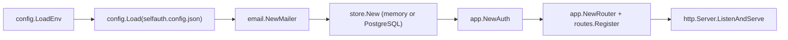

# Gin (Go) project structure

`npx selfauth init my-api --backend gin --database postgresql --module github.com/you/my-api` creates a Go module in the usual Go layout: programs in `cmd/`, private packages in `internal/`.

Gin projects work with PostgreSQL or the in-memory store, and only for new projects, so `selfauth add` doesn't apply to Go. You need Go 1.26 or newer. `doctor`, `validate`, `diff` and `upgrade` all work. Add `--frontend vue` or `--frontend react` and the Go module moves into `server/`, next to a `client/` frontend, as [described below](#with-a-frontend).

## The tree

```text
my-api/
├── cmd/                              # programs (each folder is a `main` package)
│   ├── server/main.go                # ★ starts the HTTP server
│   ├── migrate/main.go               # applies SQL migrations: status | up
│   ├── seed/main.go                  # writes roles and permissions to the database
│   └── create-admin/main.go          # gives an existing account the admin role
├── internal/                         # private packages
│   ├── routes/
│   │   ├── routes.go                 # ★ YOUR routes: the Register function
│   │   └── routes_test.go
│   ├── email/
│   │   └── mailer.go                 # ★ plug in your email provider (NewMailer)
│   ├── config/
│   │   ├── config.go                 # loads and validates selfauth.config.json
│   │   ├── env.go                    # reads and validates environment variables
│   │   └── testdata/default.json     # the default settings the tests check against
│   ├── app/
│   │   ├── app.go                    # NewRouter: middleware order, /health, /auth, your routes, 404
│   │   ├── wire.go                   # NewAuth: builds the service and the Gin adapter
│   │   └── app_test.go
│   ├── auth/                         # ⚠ the security core: no HTTP, do not edit
│   │   ├── service.go                #   register, login, sessions, tokens, admin operations
│   │   ├── password.go               #   Argon2id hashing
│   │   ├── crypto.go                 #   random tokens and hashes
│   │   ├── ratelimit.go              #   rate limiter
│   │   ├── authz.go                  #   permissions, policies, ownership helpers
│   │   ├── store.go                  #   the Store interface
│   │   ├── mailer.go, email.go, errors.go, logger.go, clock.go, common_passwords.go
│   │   └── *_test.go
│   ├── ginauth/                      # ⚠ the Gin adapter
│   │   ├── ginauth.go                #   cookies, CORS, session, CSRF, guards
│   │   └── routes.go                 #   the /auth routes
│   ├── httpx/httpx.go                # request ids, error responses, JSON body limit
│   └── store/
│       ├── store.go                  # picks the store from DATABASE_URL
│       ├── memory/                   # in-memory store
│       ├── postgres/                 # pgx store + migration runner
│       └── storetest/                # shared tests every store must pass
├── db/migrations/
│   └── 20261116085533_selfauth_init/migration.sql   # plain SQL: read it
├── selfauth.config.json              # ★ authentication and authorization settings
├── selfauth.manifest.json
├── go.mod, go.sum
├── .env.example
├── .gitignore
└── README.md
```

## How it starts

`cmd/server/main.go` runs these steps in order. If one fails, it prints the problem and exits with code 1.



## Things that differ from the Node projects

| Topic | Gin project |
| --- | --- |
| Settings file | `selfauth.config.json` (JSON, not TypeScript). The server finds it in the current directory, or at the path in `SELFAUTH_CONFIG`. Run the server from the project root. |
| Environment | The process environment. A `.env` file is not loaded by the server. Export the variables, or use a tool such as direnv. |
| Environment name | `APP_ENV` (`development`, `test`, `production`) instead of `NODE_ENV` |
| Module path | The `--module` you passed. All imports use it, for example `github.com/you/my-api/internal/auth`. |
| Migrations | `go run ./cmd/migrate status` and `up` (or `npx selfauth db status` and `migrate`). No ORM. |
| Request bodies | SelfAuth's middleware parses the JSON body once. In your handlers read it with `httpx.Body(c)`, not `c.ShouldBindJSON`. |
| Tests | `go vet ./... && go test ./...` |

## Your routes

`internal/routes/routes.go` looks like this:

```go
func Register(r *gin.Engine, a *ginauth.Auth) {
	api := r.Group("/api")
	api.GET("/hello", a.RequireAuth(), func(c *gin.Context) {
		c.JSON(http.StatusOK, gin.H{"hello": a.Context(c).User.Email})
	})
}
```

`a.RequireAuth()` is the guard, and `a.Context(c)` returns the signed-in user. See [Add an API route](/build/add-api-route) and the [Go API reference](/api/go).

## Commands

| Command | What it does |
| --- | --- |
| `go run ./cmd/server` | Starts the server |
| `go run ./cmd/migrate status` | Lists applied and pending migrations (needs `DATABASE_URL`) |
| `go run ./cmd/migrate up` | Applies pending migrations, each in its own transaction |
| `go run ./cmd/seed` | Writes roles and permissions from `selfauth.config.json` |
| `go run ./cmd/create-admin you@example.com` | Grants the admin role |
| `go vet ./... && go test ./...` | Checks and tests |
| `go build -o bin/server ./cmd/server` | Builds a binary |

## With a frontend

`npx selfauth init my-app --backend gin --frontend react --module github.com/you/my-app` creates the same shape as the Node full-stack projects: two packages and a thin root.

```text
my-app/
├── server/                  # everything in the tree above, as a Go module
│   ├── cmd/, internal/, db/migrations/
│   ├── selfauth.config.json
│   ├── .env.example         # copy to server/.env
│   └── selfauth.manifest.json
├── client/                  # the Vue or React app: see "Full stack: Vue or React"
├── scripts/
│   └── dev-server.mjs       # starts the Go server for `npm run dev`
└── package.json             # npm workspace root (the client), with scripts for both
```

```bash
cd my-app
npm install                          # installs the client
cp server/.env.example server/.env   # set DATABASE_URL if you use PostgreSQL
npm run db:migrate && npm run db:seed
npm run dev                          # the Go API on :3000 and the app together
```

The root scripts wrap the Go commands: `npm run dev`, `build`, `typecheck` (`go vet` plus the client's type check), `test` (`go test`), and, with PostgreSQL, `db:migrate`, `db:status`, `db:seed` and `db:create-admin`. The Go server reads the process environment and never a `.env` file, so `scripts/dev-server.mjs` loads `server/.env` before it starts the server. Your own routes still go in `server/internal/routes/routes.go`, and your pages in `client/src/pages/`.

The browser test suite that runs against the Node backends runs against the Go server too, for both Vue and React.

