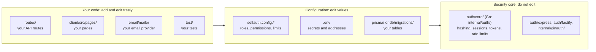

# Project structure overview

`selfauth init` creates one of four shapes. Pick the page for yours:

| You ran | Shape | Page |
| --- | --- | --- |
| `init` (Express, no frontend) | One package | [Express API](./express) |
| `init --backend fastify` | One package | [Fastify API](./fastify) |
| `init --backend gin` | One Go module | [Gin (Go) API](./gin) |
| `init --frontend vue` or `react` | `server/` + `client/` in one workspace | [Full stack](./full-stack) |

The database you choose adds or removes a few files: see [What each database changes](./databases).

## Ownership map

All generated files are yours. You can edit any of them. But they fall into three groups, and knowing which is which tells you where to work.



| Group | Where | What to do |
| --- | --- | --- |
| Your code | `routes/`, `email/mailer`, `client/src/pages/`, `client/src/App.*`, `client/src/router.ts`, `test/` | Edit and add files. This is where your app lives. |
| Configuration | `selfauth.config.ts` or `.json`, `.env`, `prisma/schema.prisma`, `db/migrations/`, `package.json` | Change values. Re-run the seed when roles change. |
| Security core | `src/auth/core/`, `src/auth/stores/`, adapter folders, `internal/auth/`, `internal/ginauth/`, `internal/store/` | Do not edit unless you must. This code is covered by the conformance suite. |

If you edit a security-core file, `selfauth validate` lists it as changed, and `selfauth upgrade` will write a `.selfauth-new` proposal next to it instead of replacing it. See [`diff` and `upgrade`](/cli/upgrade).

## Where do I add...?

| I want to add... | Put it here | Guide |
| --- | --- | --- |
| An API endpoint | `src/routes/` (Go: `internal/routes/`) | [Add an API route](/build/add-api-route) |
| A rule that a route needs a permission | In the route: `auth.requirePermission("x.y")` | [Protect routes](/build/protect-routes) |
| A new permission or role | `selfauth.config.ts` (Go: `selfauth.config.json`), then run the seed | [Permissions and roles](/build/permissions-roles) |
| "Users only see their own rows" | A policy registered with `auth.policies.register` | [Resources and ownership](/build/resource-ownership) |
| A frontend page | `client/src/pages/` and `client/src/router.ts` (React: `client/src/App.tsx`) | [Add a frontend page](/build/frontend-pages) |
| Your own database table | `prisma/schema.prisma` + a migration (Go: a new SQL file) | [Change the database](/build/database-changes) |
| Real emails | `src/email/mailer.ts` (Go: `internal/email/mailer.go`) | [Send real email](/build/email) |
| Different password length, session length or limits | `selfauth.config.*` | [The configuration file](/configuration/config-file) |
| A new environment variable | `src/config/env.ts` (Go: `internal/config/env.go`) | [Environment variables](/configuration/environment) |
| Tests | `test/` (Go: `*_test.go` next to the code) | [Write tests](/build/tests) |

## Files at the project root

| File | Purpose |
| --- | --- |
| `selfauth.manifest.json` | The list of files SelfAuth wrote and a fingerprint of each. Used by `doctor`, `validate`, `diff` and `upgrade`. Commit it. |
| `.env.example` | A template for your `.env`. Contains placeholders only. Commit it. |
| `.env` | Your real settings. Never commit it. It is ignored by `.gitignore`. |
| `README.md` | A short guide generated for the project |
| `.gitignore` | Ignores `node_modules`, `dist`, `.env` and generated code |

## What `selfauth.manifest.json` contains

```json
{
  "toolkit": "selfauth",
  "version": "0.15.0",
  "templateVersion": "0.15.0",
  "specVersion": "0.1",
  "database": { "type": "postgresql", "orm": "prisma" },
  "ownedResources": {
    "tables": ["auth_users", "auth_credentials", "auth_sessions", "..."],
    "types": ["auth_account_state", "..."],
    "migrations": ["20261116085533_selfauth_init"]
  },
  "options": { "layout": "project", "srcDir": "src", "backend": "express", "frontend": "none", "permissions": [] }
}
```

The file also holds a `files` list with a fingerprint (hash) of each generated file. `ownedResources` names the database tables SelfAuth created, so `selfauth db plan` can warn if a migration touches tables that are not SelfAuth's.
